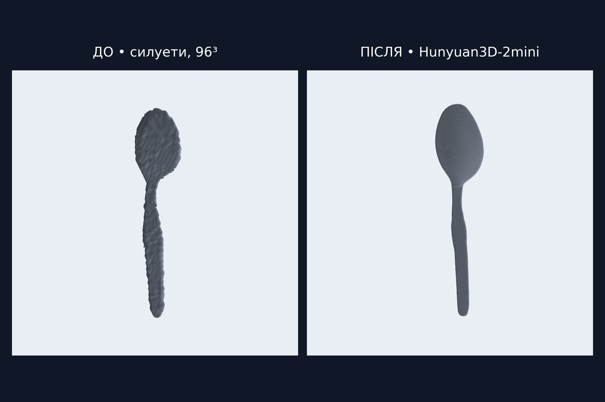
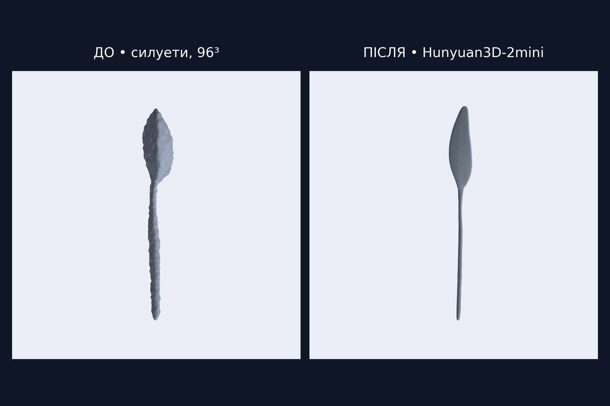
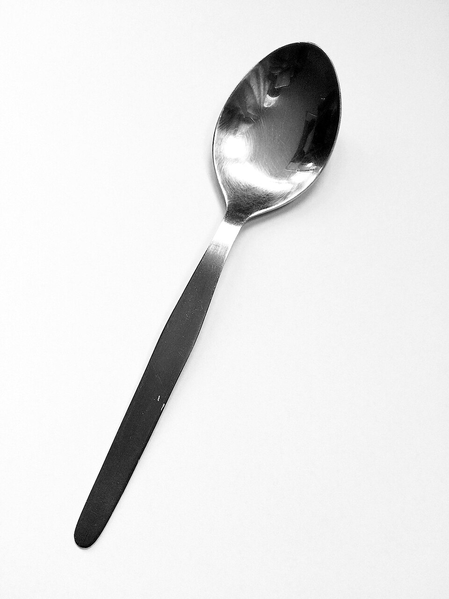
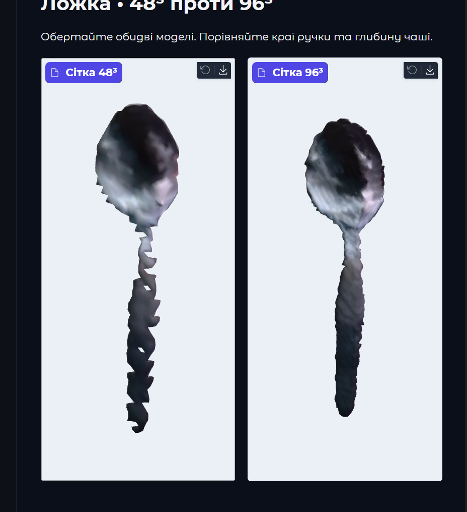

> Історичне порівняння. Силуетний сценарій видалено; залишено Hunyuan3D.

# Від силуетної реконструкції до Hunyuan3D-2mini

Експеримент із фотографією ложки, 11 листопада 2026 року.

## Результат для презентації

Початковий метод будував об’єм за шістьма згенерованими силуетами. Він давав нерівну поверхню та спотворену форму ручки й чаші. Збільшення сітки з 48³ до 96³ покращило контури, але форма залишалась незадовільною. Пряма генерація геометрії Hunyuan3D-2mini з того самого початкового фото дала візуально значно переконливішу ложку.

Це рендери фактичних GLB-файлів. Для порівняння прибрано колір, моделі вирівняно за головними осями та масштабовано до однакової довжини. Камера, освітлення і матеріал однакові. Вершини та грані збережено, додаткове згладжування для ілюстрацій не застосовувалось. Орієнтація показу нормалізована окремо для кожної моделі, тому це ілюстрація форми, а не каліброване метричне порівняння.

## Вхідне фото

## Попередня техніка

**Фото → підготовка → Zero123++ v1.2 → шість ракурсів → rembg → бінарні маски → space carving → marching cubes → очищення → Taubin smoothing → колір вершин → GLB.**

Zero123++ генерує зображення предмета з різних напрямків. У нашому експерименті використані збережені результати з seed 42 та 28 кроками генерації. Маски отримані через u2netp, поріг alpha для реконструкції становив 128. Призначені камери мали FOV 30° і distance 4. Офіційний опис моделі та ракурсів наведений у репозиторії Zero123++. [Джерело](https://github.com/SUDO-AI-3D/zero123plus)

Space carving проєктує кожен воксель у шість масок і залишає його лише за належності всім силуетам. Marching cubes перетворює отриманий об’єм на трикутну поверхню. Далі застосовуються очищення та п’ять ітерацій згладжування.

### Чому форма була поганою

- Силуети обмежують зовнішній об’єм. Заглиблення, яке не впливає на контур, недостатньо визначене.
- Метод чутливий до узгодженості ракурсів, масок і заданих камер. Помилка одного контуру може видалити частину тонкої ручки. Внесок кожної причини в цьому експерименті окремо не вимірювався.
- На сітці 48³ тонкі деталі представлені малою кількістю вокселів. Сітка 96³ зменшила дискретизацію, але зберегла обмеження самого методу.
- Перенесені з фото відблиски металу додатково спотворювали сприйняття поверхні. Перегляд без кольору підтвердив наявність проблем у геометрії.

### Скриншот попереднього результату

Це наданий користувачем скриншот браузера. Парні зображення вище показують окремо геометрію старої моделі 96³ та нового результату. Замість нового браузерного скриншота використано рендер GLB через недоступність інструмента захоплення екрана.

## Нова техніка

**Початкове фото → видалення фону u2netp → Hunyuan3D-2mini → декодування геометрії → трикутна сітка → GLB.**

Hunyuan3D-2mini — навчена модель генерації форми за зображенням. Вона використовує ознаки фото та засвоєні закономірності тривимірних об’єктів, щоб сформувати узгоджене представлення геометрії. Декодер перетворює це представлення на поверхню. Офіційний API повертає mesh, який можна експортувати в GLB. [Джерело](https://github.com/Tencent-Hunyuan/Hunyuan3D-2)

У цьому запуску Hunyuan отримав початкове фото після видалення фону. Шість ракурсів Zero123++ у новому шляху не використовувались. Покращення узгоджується зі здатністю навченої моделі формувати цілісну поверхню за ознаками фото та попередньо засвоєними закономірностями. Це пояснення механізму, а не окремий експеримент із причинності.

## Параметри та вимірювання

| Параметр | Попередній метод | Новий метод |
|---|---|---|
| Вхід для побудови форми | 6 масок згенерованих ракурсів | Фото після видалення фону |
| Реконструктор | Space carving + marching cubes | Hunyuan3D-2mini |
| Роздільність | Воксельна сітка 96³ | Параметр octree_resolution 256 |
| Вершини | 4 338 | 40 048 |
| Трикутники | 8 672 | 80 096 |
| Додаткове згладжування | 5 ітерацій Taubin | У тестовому скрипті не застосовувалось |
| Колір у парному порівнянні | Нейтральний матеріал | Нейтральний матеріал |

Роздільності двох методів мають різний зміст. Кількість трикутників характеризує деталізацію сітки, але сама по собі не доводить точність.

Новий запуск виконано на NVIDIA GeForce RTX 4060 Laptop GPU з 8 ГБ VRAM у режимі CUDA FP16. Параметри становили 50 кроків, seed 42 та num_chunks 4000. Час виклику генерації — **28,17 с**, включно з декодуванням поверхні, без встановлення, завантаження ваг, підготовки фото та експорту GLB. Режим CPU offload завершився помилкою бібліотеки, успішний результат отримано у звичайному GPU-режимі.

Для попереднього методу середній IoU силуетів зріс із 87,7% на 48³ до 93,0% на 96³. Це збіг проєкцій зі згенерованими масками, а не точність відносно справжньої ложки. Для Hunyuan цей показник не обчислювався.

## Формулювання для усного виступу

> Спочатку ми відновлювали об’єм із шести згенерованих силуетів. Збільшення роздільності зробило контури рівнішими, проте зберегло спотворену геометрію. Потім ми випробували Hunyuan3D-2mini, який генерує форму безпосередньо з фотографії. На прикладі ложки отримали рівнішу поверхню та значно правдоподібніші пропорції ручки й чаші. Результат перевіряли без кольору, щоб оцінювати саме геометрію.

## Межі висновку і відтворення

Це порівняння одного предмета та одного успішного запуску Hunyuan. Еталонного 3D-скану немає, точність товщини й глибини чаші не вимірювалась. Невидимі частини модель прогнозує. Новий генератор працює як окремий локальний експеримент і ще не інтегрований в основний сайт.

- Код Hunyuan взято з коміту `f8db63096c8282cb27354314d896feba5ba6ff8a`.
- Ваги — `tencent/Hunyuan3D-2mini`, підпапка `hunyuan3d-dit-v2-mini`, варіант `fp16`, revision `f90a0f7df7d5e6f71109cf333f6a95a0ae3194a6`.
- Локальний запуск — `data/run_hunyuan_spoon.py`.
- Старий GLB — `data/spoon_comparison_96/neutral.glb`.
- Новий GLB — `data/hunyuan_spoon/model.glb`.
- Числові результати збережені поруч із зображеннями у [hunyuan_metrics.json](assets/reconstruction/hunyuan_metrics.json) та [silhouette_metrics.json](assets/reconstruction/silhouette_metrics.json).
- Папка `data/` виключена з Git. Цей Markdown і зображення в `docs/assets/reconstruction/` можна зберігати в репозиторії та переносити разом.

## Наступний етап: текстурування

Окреме [порівняння текстур до та після Hunyuan Paint](texture_comparison.md)
показує результати на яблуці, згенеровані ракурси та обмеження методу.
