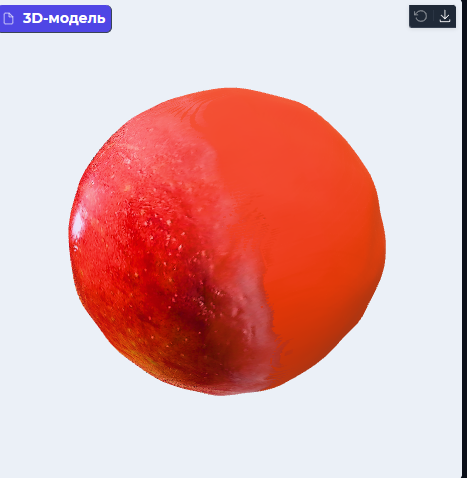
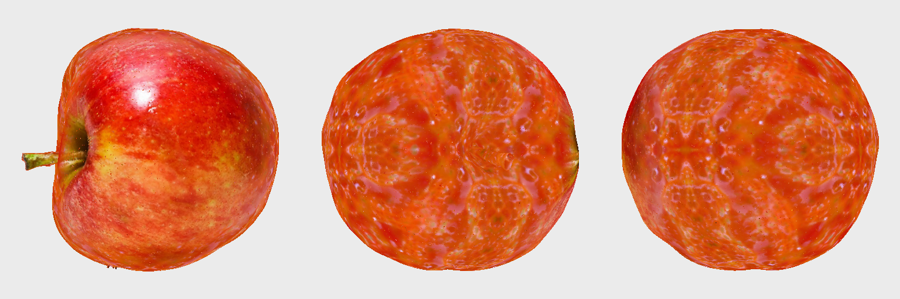
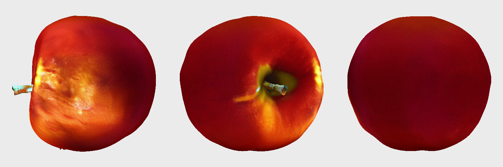
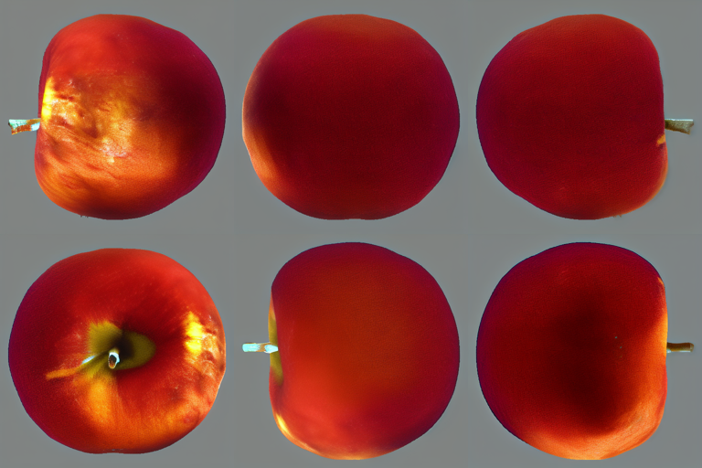
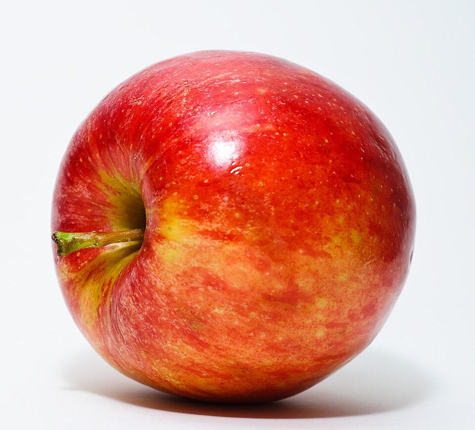

# Текстурування: до та після Hunyuan Paint

Порівняння на фотографії яблука. Перевірено локально на RTX 4050 Laptop 6 GB.

## Початковий результат: колір вершин

Скриншот користувача: одна фотографія проєктується на вершини mesh.
Невидимі ділянки заповнюються усередненим кольором або дзеркальною проєкцією.
Видно однотонну область і різкий перехід. У цьому GLB не було UV-текстури.
Цей скриншот має інший ракурс та освітлення, ніж контрольні рендери нижче.

## До: згенерований фрагмент матеріалу

BLIP сформував опис «a red apple with a green stem». Stable Diffusion 1.5
отримав опис і фрагмент шкірки з фото; отриманий матеріал переносився
на приховані ділянки через UV. Передня сторона зберегла фото, проте ззаду
з'явилися грубий повторюваний малюнок і неприродні світлі плями.
Цей експеримент показав, що опис і фрагмент матеріалу недостатньо враховують
розташування деталей на предметі.

## Після: ракурси, узгоджені з геометрією

Hunyuan Paint отримав вихідне фото та карти нормалей і позицій готового mesh.
Шість згенерованих ракурсів перенесено на спільну UV-текстуру, вбудовану в GLB.
На цьому прикладі прихована поверхня виглядає однорідніше, зник характерний
повторюваний малюнок попереднього способу. Залишилися неприродний колір
плодоніжки, відблиски та втрата дрібних деталей. Це покращення одного прикладу,
а не гарантія якості для інших предметів.

## Умови порівняння

- Два контрольні рендери показують фактичні GLB при поворотах 0°, 120°, 240°.
- Використано однаковий ортографічний CPU-рендер без додаткового освітлення;
  кожен ракурс вписано в кадр. Кольори зчитуються з текстури, без ретуші.
- Геометрія відрізняється: попередній файл містить 578 388 трикутників,
  Paint використовує спрощену копію з 60 000. Тому це порівняння двох
  результатів процесу, а не ізольований вимір впливу текстури.
- Успішний Paint: шість ракурсів 512×512, UV 1024×1024, model CPU offload.
- Пікова пам'ять, виділена PyTorch: 4 393 466 880 байт ≈ 4,09 ГіБ.
  Це не повне використання VRAM усіма процесами.
- Проба Paint на 256×256 дала сильні кольорові артефакти й була відхилена.
- Приховані поверхні синтезовані: з одного фото їх справжній вигляд невідомий.

## Вхідне фото та відтворення

Інструкції запуску: [локальний Hunyuan Paint](local_paint.md).
Параметри й контрольні суми зображень: [metrics.json](assets/texturing/metrics.json).

Локальні джерела контрольних рендерів:
`data/texture_trial_v2/model.glb` і `data/paint_trial_512/model.glb`.
Великі GLB та ваги моделей залишаються в data/; зображення й цей документ
зберігаються в Git і доступні для презентації без встановлення моделей.
